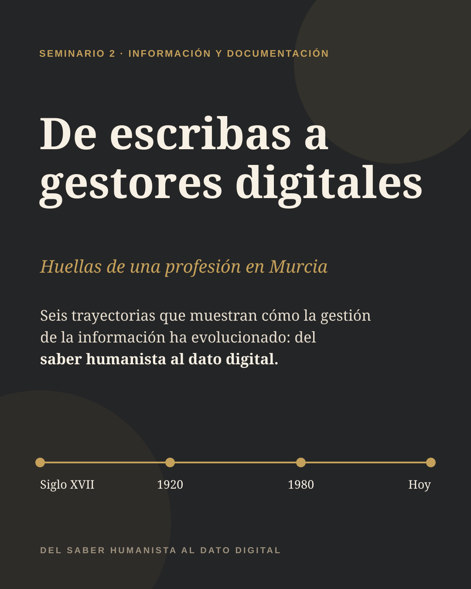
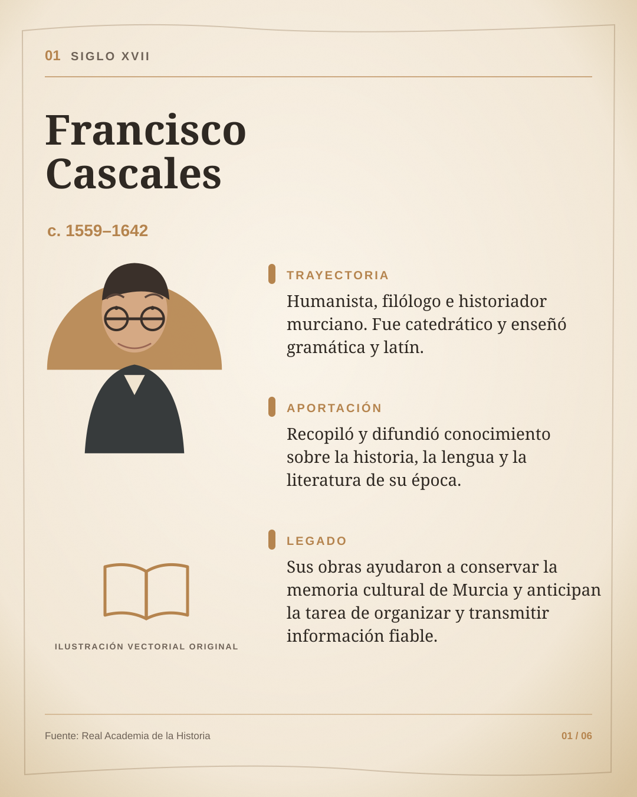
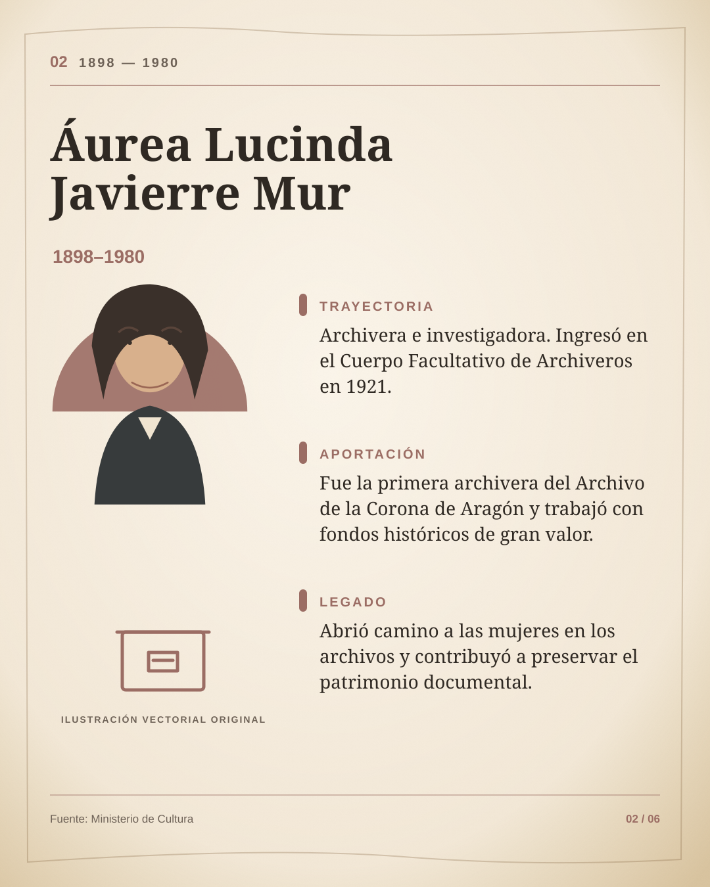
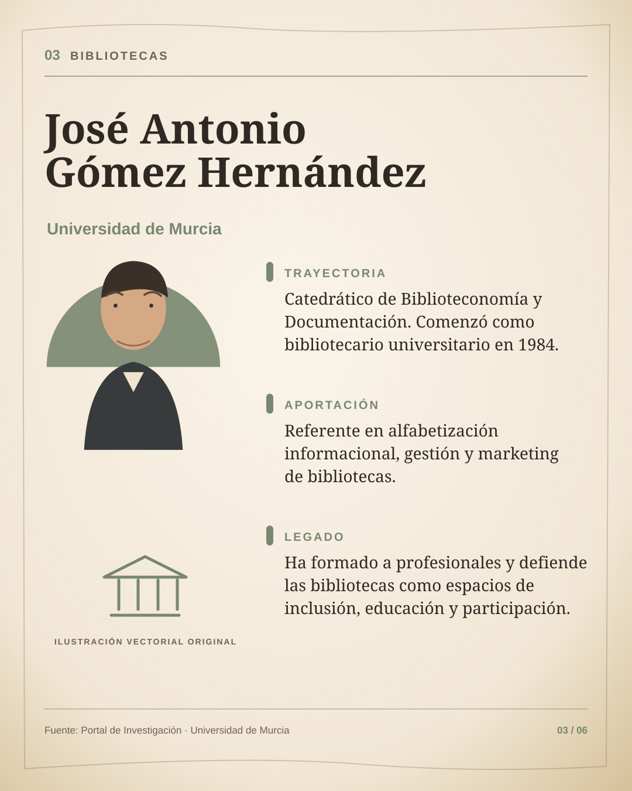
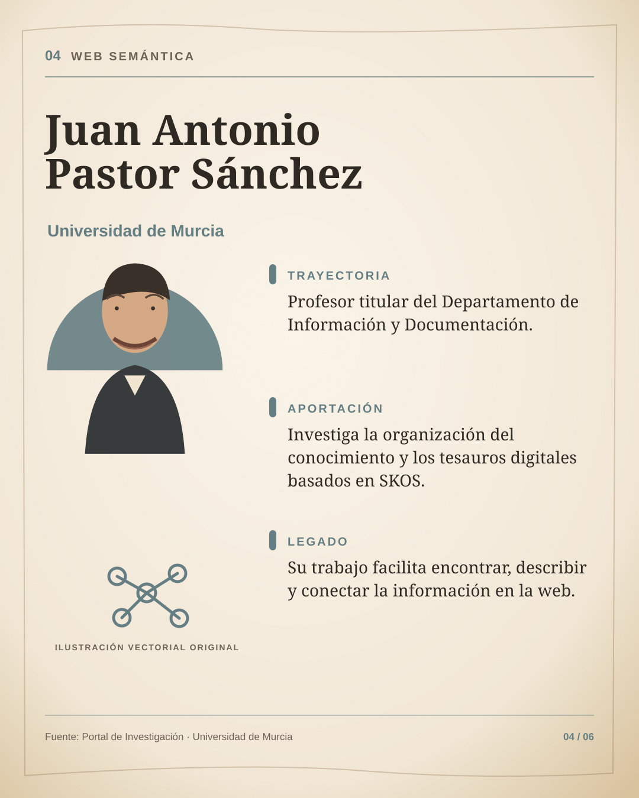
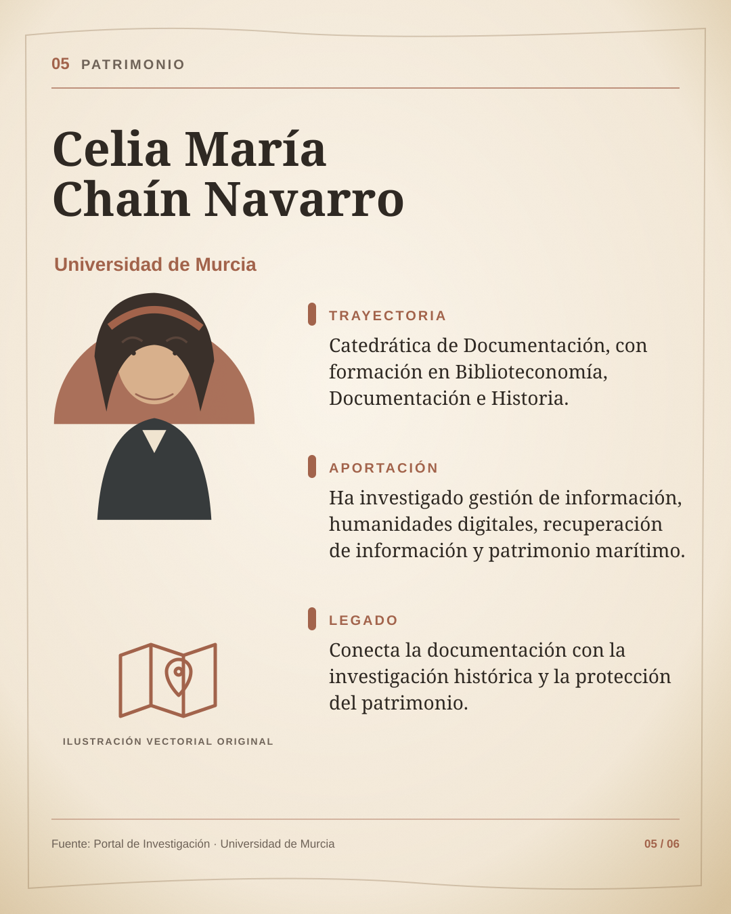
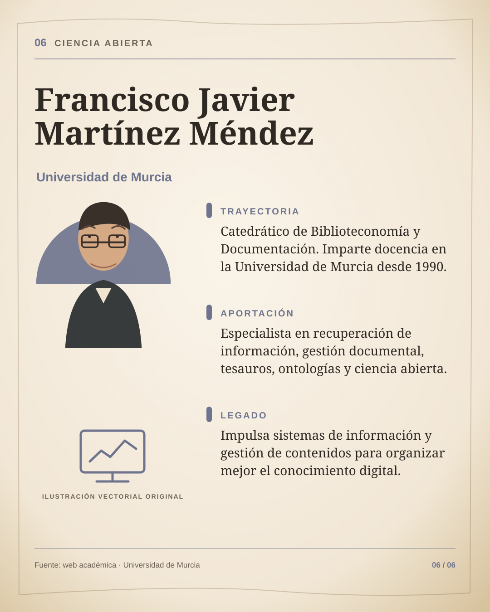

# De escribas a gestores digitales

**Seminario 2 · Huellas de una profesión en Murcia**

## Nuevo: póster de una sola página

- [Ver el póster A3 vertical](./poster-seminario-2-a3.svg)
- [Descargar el póster en ZIP](./poster-seminario-2-a3.zip)
- [Abrir la presentación del póster](./poster.html)

El póster mide **2480 × 3508 px (A3 vertical)** y reúne los seis perfiles, la línea temporal, la conclusión y las fuentes en una sola composición.

Carrusel informativo vertical de **8 diapositivas (1080 × 1350 px)** sobre la evolución de la gestión de la información, desde el saber humanista hasta el dato digital.

## Descargar

- [Descargar las 8 diapositivas en ZIP](./seminario-2-carrusel-vertical.zip)
- [Abrir la vista conjunta del carrusel](./carrusel.html)

> Para usarlo en Canva, descarga el ZIP, descomprímelo y sube los ocho archivos SVG. Los SVG mantienen la máxima calidad y el formato vertical 4:5.

## Diapositivas

### 1. Portada
[Descargar SVG](./diapositiva-1-portada.svg)

### 2. Francisco Cascales
[Descargar SVG](./diapositiva-2-francisco-cascales.svg)

### 3. Áurea Lucinda Javierre Mur
[Descargar SVG](./diapositiva-3-aurea-javierre.svg)

### 4. José Antonio Gómez Hernández
[Descargar SVG](./diapositiva-4-jose-antonio-gomez.svg)

### 5. Juan Antonio Pastor Sánchez
[Descargar SVG](./diapositiva-5-juan-antonio-pastor.svg)

### 6. Celia María Chaín Navarro
[Descargar SVG](./diapositiva-6-celia-chain.svg)

### 7. Francisco Javier Martínez Méndez
[Descargar SVG](./diapositiva-7-francisco-javier-martinez.svg)

### 8. Fuentes consultadas
[Descargar SVG](./diapositiva-8-fuentes.svg)

## Personalización final

Antes de entregar el trabajo, sustituye la línea **“EQUIPO”** de la diapositiva 8 por los nombres de los integrantes.

Las ilustraciones incluidas son vectoriales y originales; no dependen de fotografías externas ni requieren atribución de terceros.
